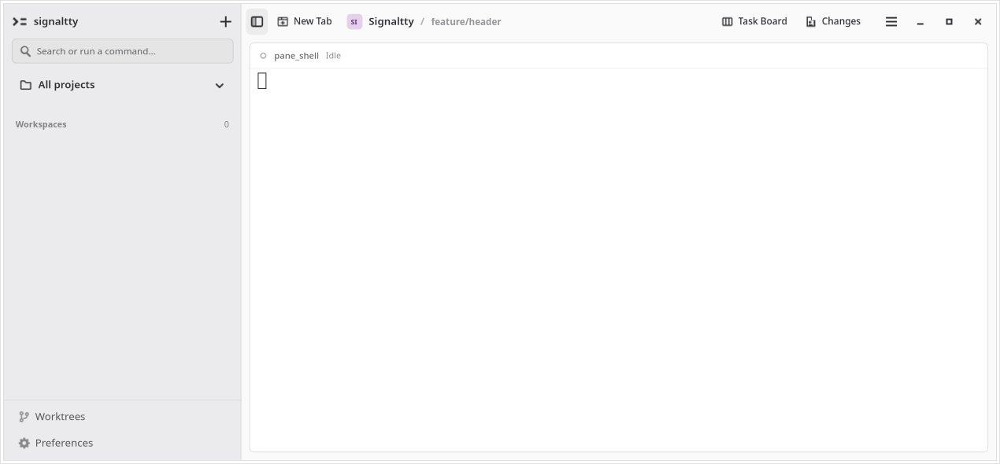
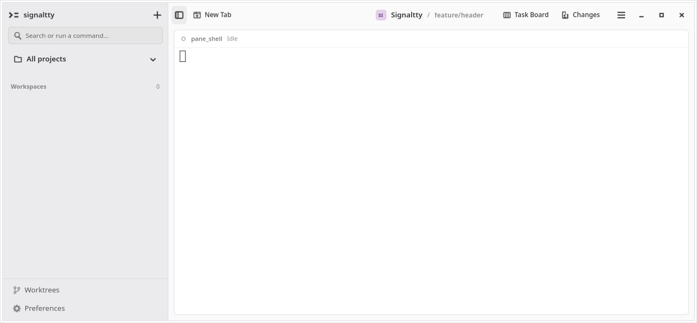
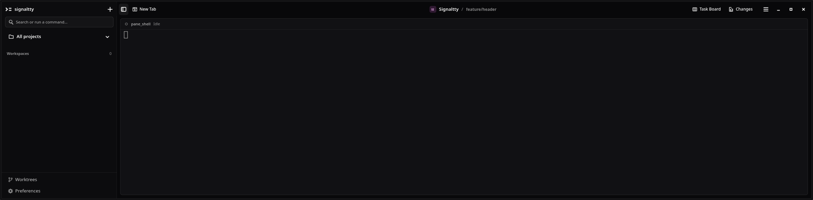
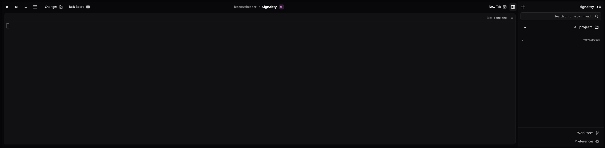
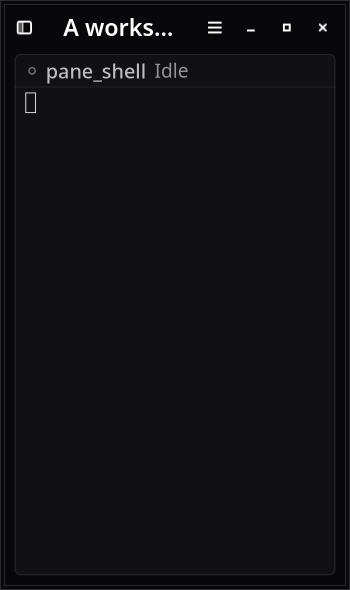
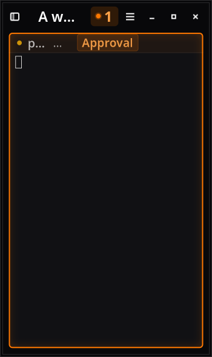
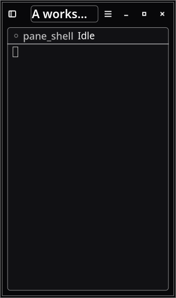

# Centered workspace identity

Verified source `c260e947336a2a4f62b9f094c6e6cbd072019d53`, base `bc39d5b4dfc515dfb9792f3ac368d0045da871b2` includes merged PR109. The user clarified that centered placement was correct and only spacing between repository and branch needed correction.

The compact identity returns to the native HeaderBar center title widget. Mark/name/context keep their natural width and bounded gaps. Spacious content uses Strict centering; both compact breakpoints below 860sp restore Loose centering. The existing native drag reservation is packed separately at the leading edge, preserving 24px/12px without displacing or reducing the centered identity.

## Proof

- [Baseline red](baseline-red.log): center-position assertion added to the merged PR109 layout fails with 246px offset in the actual 1270px window. Changes is fully closed before capture.
- [Dedicated native run](native-wide.log): actual 1270px and 2390px LTR/RTL windows, 0px identity midpoint offset relative to the content header. Short title allocation 58px equals ink 58px. Internal gaps remain at most 16px.
- Narrow long title 128px at Sans11/Sans18, 75px with attention. Details metadata, native keyboard traversal, drag reservation, docked Changes adaptation and retained VTE identity pass the existing App-seam assertions.
- [High contrast](native-high-contrast.log): same test passes with `ADW_DEBUG_HIGH_CONTRAST=1` and asserts native high-contrast mode.
- [Full gate](full-summary.json): 55 steps and 43 isolated GTK tests, workspace tests, architecture, warning policy, server QA and [benchmark](refresh-benchmark.log) passed on the clean pinned source.
- [Independent reviews](reviews.md): Spec and Standards axes passed with no findings; native before/after and stress renders inspected.

Reproduce full verification with `RUST_TEST_THREADS=1 scripts/verify.sh full --output /absolute/new-directory`. Dedicated wide capture:

```sh
GTK_A11Y=none SIGNALTTY_UI_EVIDENCE=/tmp/centered-header-new xvfb-run -a -s '-screen 0 2560x1200x24' dbus-run-session -- cargo test -p signaltty-gui app::tests::workspace_header_context_survives_shell_agent_and_empty_transitions -- --exact --ignored --test-threads=1 --nocapture
```

Repeat with `ADW_DEBUG_HIGH_CONTRAST=1` and a new evidence path for the high-contrast case. The shared full runner uses a 1600px monitor and retains the same assertions with monitor-bounded wide sizing. Dedicated captures use a 2560px monitor. Native logs include portal fallback and transient GTK resize/measurement warnings; stable final states are the accepted screenshots.

## Native captures

Same 1270px fixture, Changes closed in both:

| Before | After | Why |
| --- | --- | --- |
| Compact identity at the leading edge | Compact identity centered in the content header | Matches the clarified placement |
| Internal spaces contained | Internal spaces still contained | Moves the complete group |









Actual compositor fullscreen/maximize/dragging, screen-reader speech, OSK and IME were not run. Xvfb checks native allocations and actions, not a real compositor. The complete transient full logs remain in `/tmp/centered-header-full-20261014`; the committed summary records commands, results and tool versions. Only documentation/proof commits follow the verified source.
