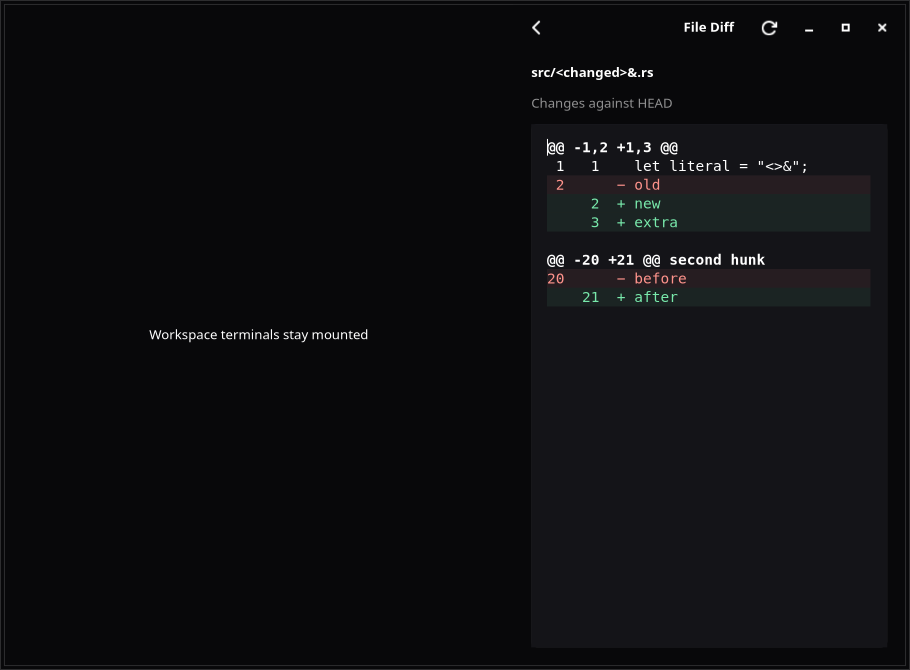
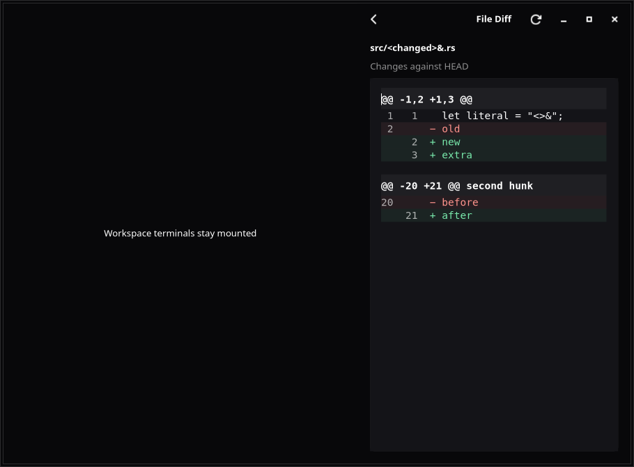
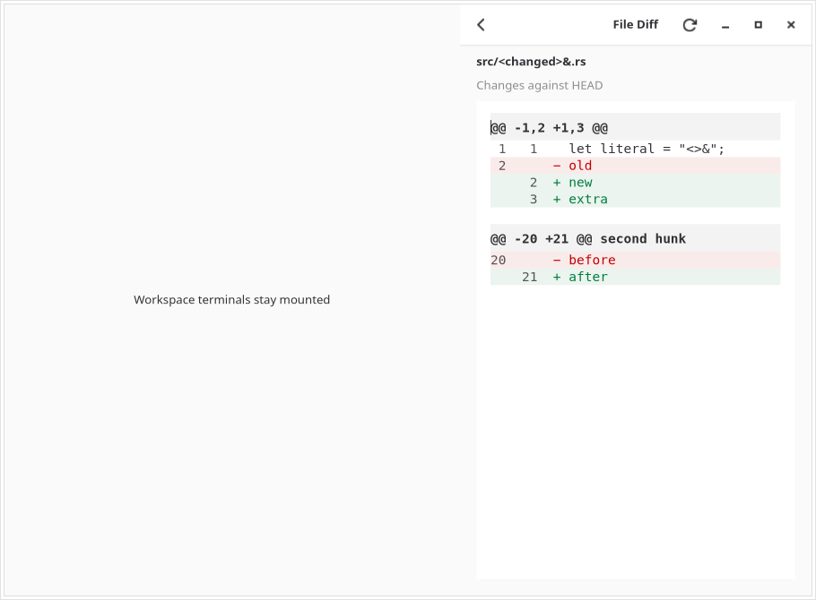
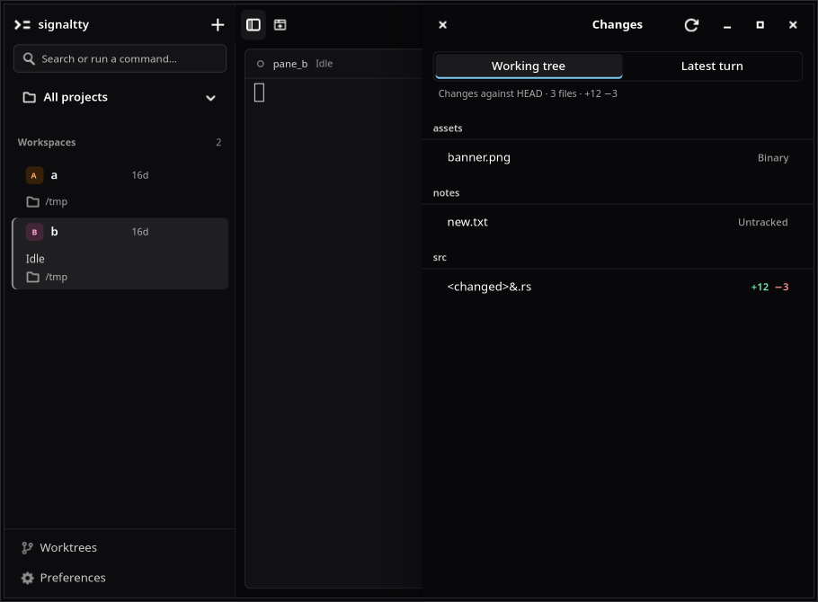
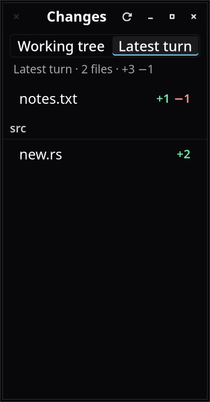
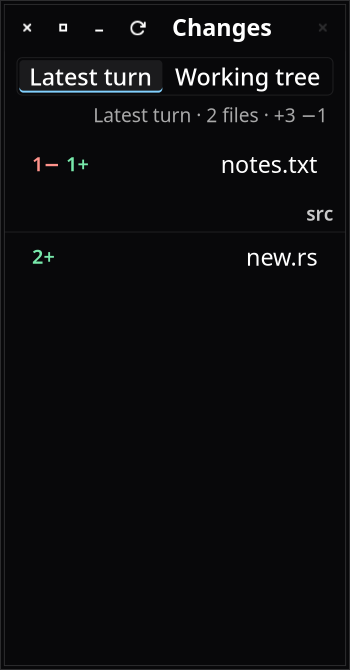
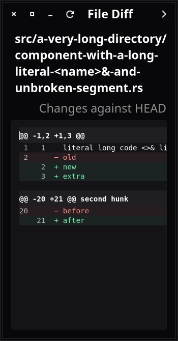
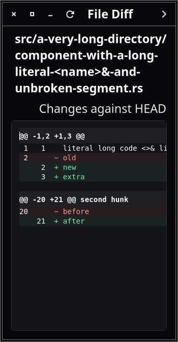
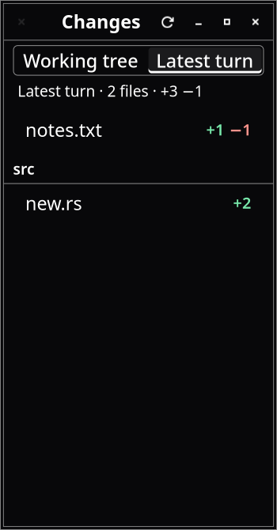

# Changes reading polish: native evidence

Baseline production `2d5b4cc519242e7ec9a6ab7b0f9b21685fda151a`. Implementation reviewed at `c18cadfa6c0f0b6e020cc4b92eb821416e63fea7`. This feature is limited to Changes and its reader, with established application roles and native widgets. No imported asset or new dependency.

## Focused behavior

[Baseline reader](baseline-reader.log) passes the original native interactions. Red [reader](red-reader.log) and [scope](red-scope.log) runs fail the added hunk-separation and visible-title requirements on baseline production.

Final focused [reader](native-reader.log) and [scope](native-scope.log) tests pass. [Native high-contrast reader](high-contrast-reader.log) and [scope](high-contrast-scope.log) pass with explicit contrast assertions. The [App workflow test](app-workflows.log) passes the actual palette/worktree/Changes workflow and retained terminal behavior.

Native acceptance covers complete scope labels at 360px with Sans 18, selected scope across RTL/resizes with no additional reads, same copied numbered buffer, native Back/focus/selection/list scroll, literal long paths, long code scrolling within the narrow reader, error/notices and rejected stale responses. Hunk-to-code gap is checked at least 4px. Number prefixes retain monospace metrics and become full foreground in high contrast.

## Visual comparison

| Before | After | Why |
| --- | --- | --- |
| All/Turn replaces the title | Changes title above Working tree/Latest turn | Panel identity and scope are visible without hover |
| Numbers have code's semantic foreground | Aligned secondary numbers, full foreground in high contrast | Code carries emphasis while locations stay readable |
| Hunk headings have ordinary row spacing | Native paragraph bands and spacing | Distinct sections are easier to scan |
| Long unbroken path can force panel width | Character-aware path wrapping and LTR code in RTL | Narrow layouts preserve path/code ordering |











The reader comparison uses the same fixture/window/state and explicit App dark CSS class. The left-side label is a test fixture representing the unchanged workspace host, not a real terminal. Actual App styling/interactions are checked separately. Scope's first unstylized baseline capture is not used as a same-theme visual comparison.

## Reproduce and final provenance

Run each existing display test in its own process:

```sh
GTK_A11Y=none SIGNALTTY_UI_EVIDENCE=/tmp/new-changes-proof xvfb-run -a -s '-screen 0 1600x1200x24' dbus-run-session -- cargo test -p signaltty-gui app::tests::file_diff_reader_uses_native_numbered_selectable_controls -- --exact --ignored --test-threads=1 --nocapture
```

Repeat with `app::tests::changes_panel_scopes_to_the_latest_turn` and with `ADW_DEBUG_HIGH_CONTRAST=1` using new evidence paths. App scene uses `app::tests::navigation_palette_fast_enter_and_git_dialogs_use_native_controls`.

These native artifacts are committed before final full verification. Final full result/content-index provenance lives in `/tmp/changes-reading-full-20261014/summary.json` and the PR's verification artifact when CI runs. The PR description records the actual verified revision and outcome. Validate against current content with `scripts/agent.sh check --phase delivery --feature 064-changes-reading-polish --evidence /tmp/changes-reading-full-20261014`. No source/unchecked nonignored handoff is written after final success.

[Independent reviews](reviews.md) found no actionable findings. Native logs include portal fallback warnings; they do not certify an actual desktop. Compositor behavior, screen-reader speech/order, OSK, IME, folder choosers and paid-provider sessions were not run.
