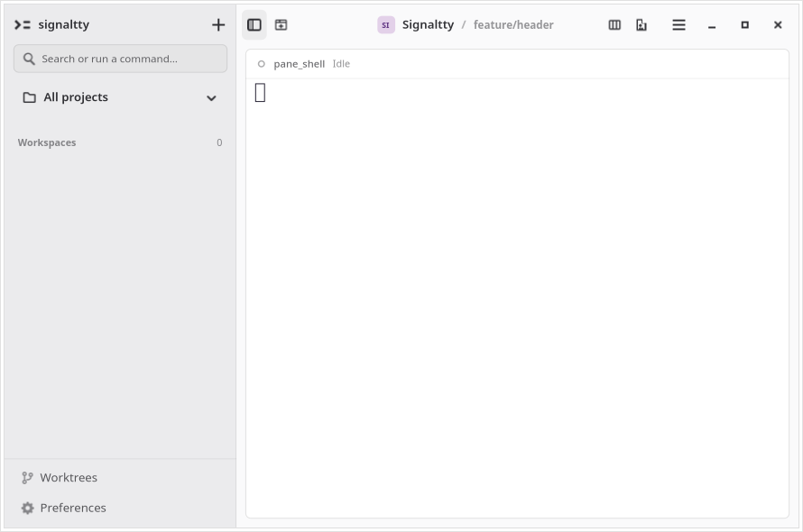
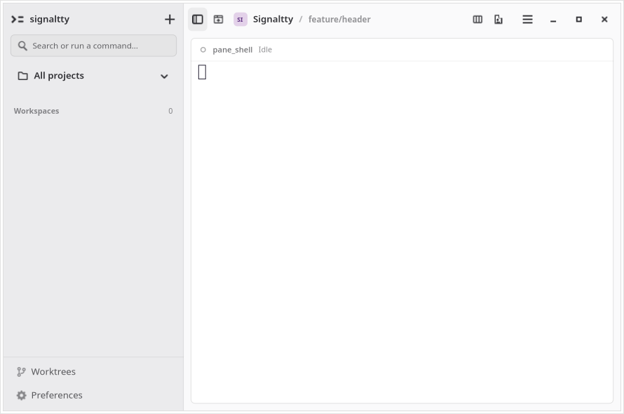
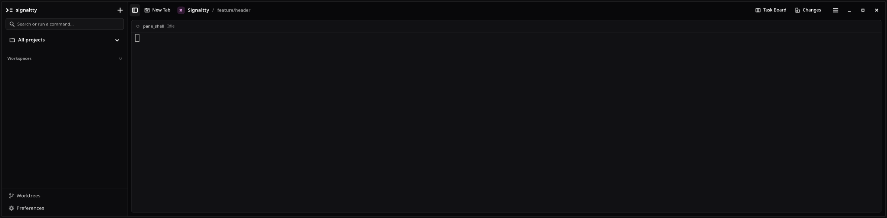
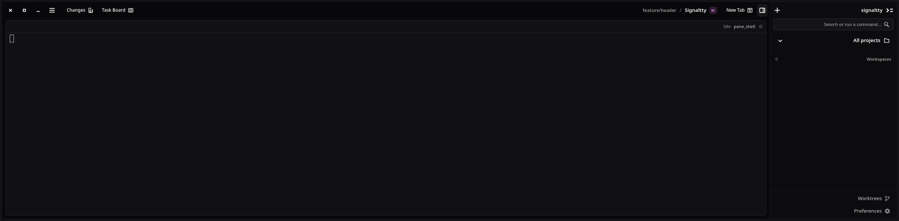
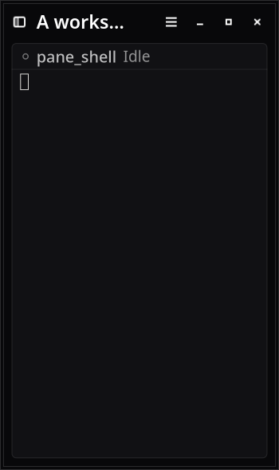
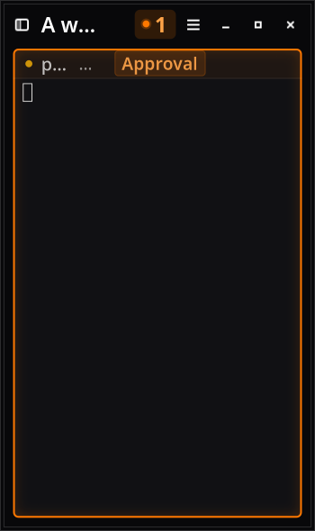

# Full-width header correction

Base `0a2cdddcd794c10b254e28e83674e76cb3f50f53`. Release source `7416ffe5382cb420fb2e727955eb04a812a6beb2`. This extends spec057 after the user supplied a wide-window screenshot.

Only blank drag space expands. Workspace mark/name/context form one compact group immediately after navigation and New Tab. Native HeaderBar, CSD, breakpoints, Details metadata, attention and terminal identity remain covered.

## Evidence

- [Baseline red](baseline-red.log): staged native regression on the baseline production layout, actual 1270px window, title 197px allocation for 58px ink.
- [Final dedicated native run](wide-native.log): same assertions at 1270px and 2390px LTR/RTL, title 58px allocation/58px ink. Narrow long title 120px at Sans11/Sans18; active attention retains 67px. Keyboard order, Details, drag-space minima and VTE identity pass.
- [Shared-display focused run](runner-native.log): up to 1510px on the 1600px monitor. The test bounds requested wide width by monitor width minus 80px, capped at 2400px. No case is skipped.
- [Toolbar interactions](tools-native.log): exact existing test passed.
- [Full gate](full-summary.json): clean source 7416ffe, 55 steps passed, 43 isolated GTK tests plus server QA and [refresh benchmark](refresh-benchmark.log).
- [Independent reviews](reviews.md): Spec and Standards axes, with visual evidence objection resolved before publication.

Reproduce with `RUST_TEST_THREADS=1 scripts/verify.sh full --output /absolute/new-directory`. For the additional wide run:

```sh
GTK_A11Y=none SIGNALTTY_UI_EVIDENCE=/tmp/header-wide-new xvfb-run -a -s '-screen 0 2560x1200x24' dbus-run-session -- cargo test -p signaltty-gui app::tests::workspace_header_context_survives_shell_agent_and_empty_transitions -- --exact --ignored --test-threads=1 --nocapture
```

## Native renders

Same 890px fixture, Changes closed in both captures:

| Before | After | Why |
| --- | --- | --- |
| Identity sits away from navigation | Identity starts immediately after navigation | Keeps workspace context in one reading group |




Wide renders below are standalone 2390px acceptance evidence. The transient 1280px light capture is excluded: it contained a strip of Changes during closing. Its mismatched panel state is not used as a comparison.






An earlier full run on 1e2b5c2 was interrupted after discovering the shared monitor clamps 2400px requests. The completed full-summary above supersedes it. Focused logs include portal fallback and GTK measurement/snapshot warnings during resizing; visual acceptance uses stable final states.

Actual compositor fullscreen/maximize/dragging, screen-reader speech, OSK and IME were not run. Xvfb geometry does not certify them. Remaining raw full logs are under `/tmp/full-width-header-full-final-20261014`; the committed summary records every command/result and tool versions.
