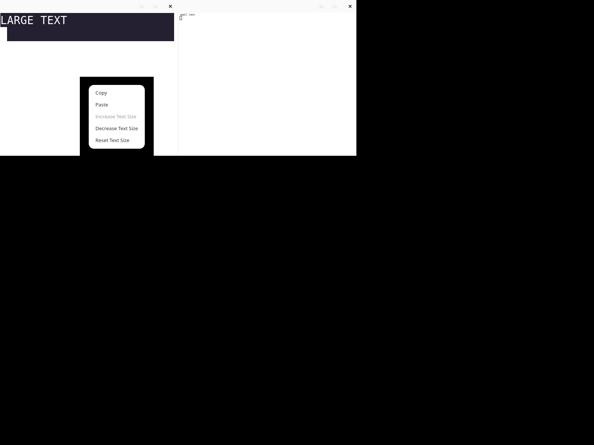
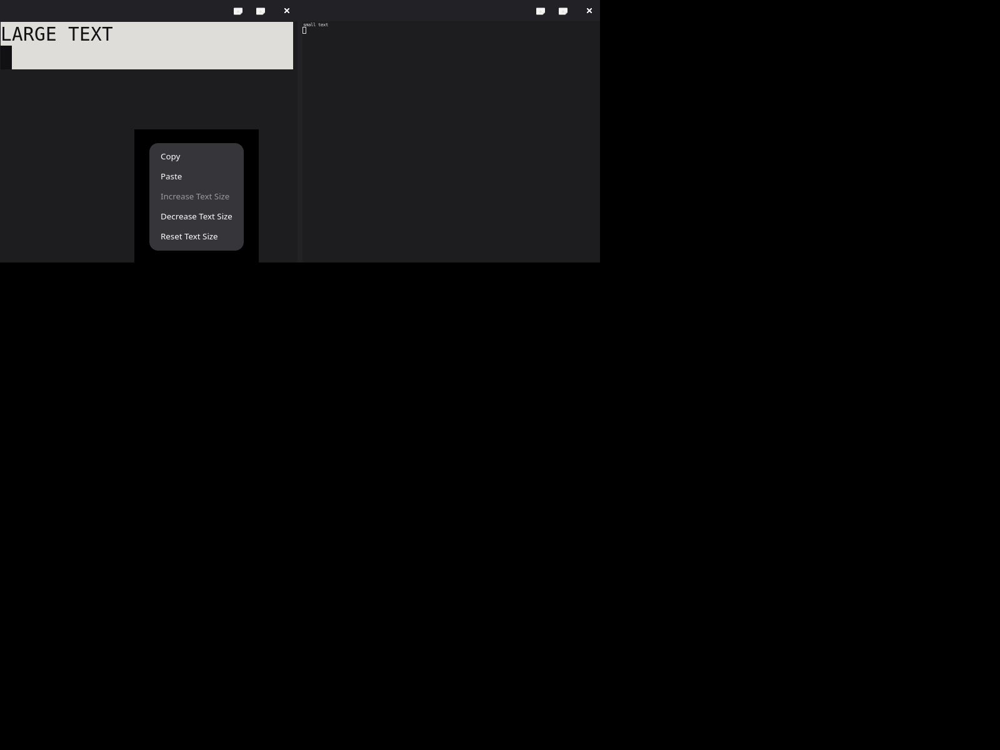

# VTE interaction evidence — 2026-10-15

These are native GTK/VTE test-window captures, inspected in light and dark.
The left pane uses 2× text and the right pane uses 0.5×. The selected left
pane enables Copy; Increase Text Size is disabled at the upper bound.

[Review decisions and limits](reviews.md) record the independent findings.




The menu images capture the Xvfb root window because VTE's popover has its
own native surface. The black area is the unused display. The companion
`terminal-scale-{light,dark}.png` files capture the GTK window alone.

Reproduce with a fresh Xvfb/D-Bus session:

```sh
SIGNALTTY_UI_EVIDENCE=/absolute/evidence/path GTK_A11Y=none \
  GDK_BACKEND=x11 GSK_RENDERER=cairo \
  xvfb-run -a -s '-screen 0 1600x1200x24' dbus-run-session -- \
  cargo test -p signaltty-gui \
  terminal::tests::terminal_scale_and_menu_render_light_and_dark \
  -- --exact --ignored --test-threads=1
```

The reference versions were GTK 4.18.6, libadwaita 1.7.6 and VTE 0.80.1.
The full verification runner repeats this test and saves fresh captures in
its evidence directory. Xvfb does not certify Wayland clipboard, IME or
assistive technology. See [spec070](../../../specs/070-vte-terminal-interactions/spec.md)
for behavioral acceptance and [ADR-0040](../../adr/0040-pane-local-vte-interactions.md)
for the native input and snapshot limits.
